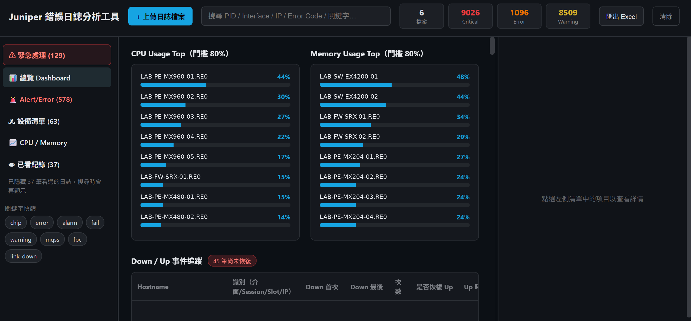

# Juniper Log Analyzer

A browser-based tool for quickly analyzing **Juniper Junos error logs** — built by a network engineer who works hands-on with Juniper MX Series routers (MX960 / MX2020 / MX480).

🔗 **Live demo:** https://ning-lee-amber.github.io/juniper-log-analyzer/

<!-- 填:放一張工具截圖。截圖存成 screenshot.png 放在 repo 根目錄,這行就會顯示圖片 -->


---

## Why I built this

During daily device health checks and maintenance windows, reading through long Junos logs line by line is slow and error-prone. This tool helps me spot critical events faster and turn raw logs into a readable summary.

## Features

- **Multi-device support** — parses syslog output from Juniper **SRX / MX / EX / QFX**, including raw SSH session captures (e.g. SecureCRT logs)
- **Batch upload** — select multiple `.log` / `.txt` files at once
- **Auto-classification** — groups messages by **severity** (Critical / Error / Warning / Notice) and by **module**
- **Keyword detection** — flags lines containing `chip`, `error`, `alarm`, `fail`, `warning`, `mqss`, `link_down`, and more
- **Flapping detection** — identifies messages that repeat rapidly (e.g. interface flaps, recurring alarms)
- **Device count** — shows how many devices were found in the logs (RE0 / RE1 count as one)
- **CPU / Memory Top** — ranks devices by CPU and memory usage against an 80% threshold
- **Down / Up event tracking** — pairs interface / session / slot down and up events, showing first & last down time, count, and which ones have not recovered
- **Keyword quick filters** — a bar at the top of the page with one-click filters and counts for `chip`, `error`, `alarm`, `fail`, `warning`, `mqss`, `fpc`, `link_down`, plus `others` for every alert none of them catch
- **Unviewed / viewed history** — 未看紀錄 lists everything you have not opened yet; 已看紀錄 keeps what you reviewed so it is hidden next time
- **Low-priority logs hidden** — routine messages stay hidden everywhere, including searches and keyword filters, until you turn them on
- **Search** — filter by PID, interface, IP address, error code, or any keyword
- **Export to Excel** — Daily Check layout: one sheet named by the ROC date (device / Version / Model / Memory / CPU / log Analysis / inspector, every cell centred, unrecovered down rows in yellow) plus an 異常備註 sheet
- **介面狂跳** — interfaces and BFD/BGP peers that went down 3+ times; the same peer flapping on two devices at once is merged and flagged as a peer/line problem
- **疑似維護** — a device where 5+ interfaces go down within one hour is flagged as a possible maintenance window
- **只看這個時間之後** — hide events before a chosen time
- **No installation** — runs in the browser; UI in Traditional Chinese

## How to use

1. Open the [live demo](https://ning-lee-amber.github.io/juniper-log-analyzer/)
2. Click **上傳日誌檔案 (Upload log files)** and select one or more `.log` / `.txt` files
3. Check 介面狂跳 and CPU / Memory, or use the keyword quick filters
4. Use the search bar to drill down by PID / interface / IP / error code

## Daily Check

網頁版只負責看 log；Daily Check 的總表請用下面的 Python 版產生。

### Python 版：直接寫進總表

**不用命令列：** 直接點兩下 `daily_check.py`（改名成 `daily_check.pyw` 就不會跳出黑色視窗），在視窗裡把總表和當天數據檔一起選起來（按住 Ctrl）、填檢查人員即可；也可以把總表和數據檔一起拖到程式圖示上。新檔會存在總表旁邊。

`daily_check.py` 會在 Daily check 總表裡複製範本工作表（格式完全沿用），新增當天的工作表，另存新檔（不覆蓋原檔）。資料可以給 raw log，也可以給網頁工具匯出的 xlsx。

```bash
pip install openpyxl
python daily_check.py 總表.xlsx 今天的log或匯出檔 --template 前一天工作表 --inspector 你的名字 --replace-name 舊名字
```

**設備清單不會寫進程式或上傳到任何地方**，只存在這台電腦的瀏覽器；換電腦時用「匯出備份 / 匯入備份」搬移。

## Data privacy

- All processing happens **locally in your browser**; logs are not uploaded anywhere
- Sample logs in this repository are **sanitized** — no real hostnames, IP addresses, or customer data

<!-- 填:如果工具其實會把資料送到外部(例如 API),請刪掉上面第一點 -->

## Tech stack

- HTML / CSS / JavaScript
- Hosted on GitHub Pages

## Roadmap

<!-- 填:之後想做的功能,沒有就整段刪掉 -->
- [ ] English UI option
- [ ] Python CLI version for batch processing

## About me

Network engineer working with Juniper MX Series — maintenance, acceptance testing, and lab builds.
**JNCIA-Junos** certified. Currently exploring network automation and cloud.

- GitHub: [@ning-lee-amber](https://github.com/ning-lee-amber)

## License

MIT
